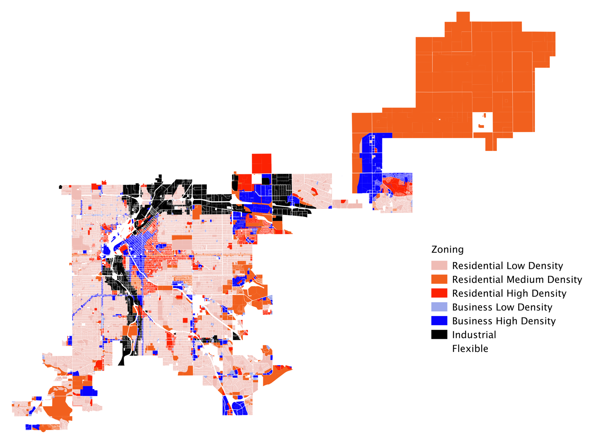
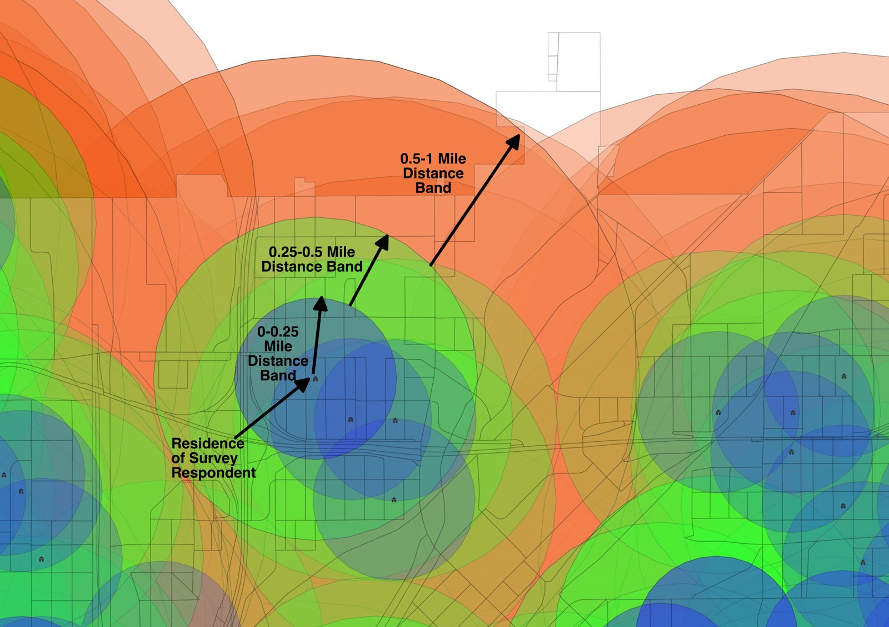

My research applies the tools of applied microeconomics to questions in **real
estate finance, sustainability, and urban economics**. A recurring theme is how
the built environment can move toward **regenerative development** — projects and
policies that restore environmental and social systems rather than merely
reducing harm. Related strands of my work examine real estate market cycles and
investment strategy, the economics of housing affordability, environmental and
social (ESG) performance in real estate, and the links between zoning, urban
form, and travel behavior.

::: {.theme-strip}
[<i class="bi bi-graph-up-arrow"></i> Market cycles & investment](publications.qmd){.chip}
[<i class="bi bi-tree"></i> Regenerative development](#paper-regenerative){.chip}
[<i class="bi bi-bar-chart-line"></i> ESG in real estate](#paper-reit-esg){.chip}
[<i class="bi bi-house-heart"></i> Housing affordability](#paper-affordability){.chip}
[<i class="bi bi-globe-americas"></i> Global capital flows](#paper-capital-flows){.chip}
:::

For published, peer-reviewed work, see [Publications](publications.qmd). Current
working papers are listed below; drafts are available on request.

## From my research {#sec-figures}

::: {layout-ncol=2}
{fig-alt="Map of the City and County of Denver colored by zoning category: low, medium and high density residential, low and high density business, and industrial."}

{fig-alt="Map of overlapping colored circles around survey respondents' residences, labelled with 0 to 0.25, 0.25 to 0.5 and 0.5 to 1 mile distance bands."}
:::

See *The Impact of Zoning and Built Environment Characteristics on Transit, Biking,
and Walking* (2019) and *Spatial Models of Travel Behavior and Land Use Restriction*
(2023) on the [Publications](publications.qmd) page.

## Working papers {#sec-working-papers}

::: {.paper-card}
::: {.paper-img style="background-image: url('assets/img/theme-finance.jpg');"}
:::
::: {.paper-body}
[ESG]{.tag} [Machine learning]{.tag}

### Assessing the Consistency of REIT ESG Scores Relative to ESG Reports {#paper-reit-esg}

[With B. Williams and A. Holder.]{.authors}

> Uses textual analysis and machine learning to evaluate how consistently the ESG
> scores assigned to real estate investment trusts (REITs) reflect the content of
> the firms' own ESG reports.
:::
:::

::: {.paper-card}
::: {.paper-img style="background-image: url('assets/img/theme-sustainability.jpg');"}
:::
::: {.paper-body}
[Regenerative development]{.tag}

### Towards Regenerative Development: Adopting Principles and Measuring Outcomes in Real Estate Projects {#paper-regenerative}

> Develops a framework for applying regenerative development principles in real
> estate, and proposes ways to measure the environmental and social outcomes of
> projects that adopt them.
:::
:::

::: {.paper-card}
::: {.paper-img style="background-image: url('assets/img/theme-housing.jpg');"}
:::
::: {.paper-body}
[Housing]{.tag} [Affordability]{.tag}

### Nowhere to Sleep at the Bottom: The Plight of Housing Affordability for the Lowest Earners in the U.S. {#paper-affordability}

[With T. J. PlaHovinsak and L. Terschan.]{.authors}

> Examines housing affordability for the lowest-income households in the United
> States and the structural gaps that leave the bottom of the market underserved.
:::
:::

::: {.paper-card}
::: {.paper-img style="background-image: url('assets/img/res-nyc.jpg');"}
:::
::: {.paper-body}
[Capital markets]{.tag} [International]{.tag}

### Global Capital Flows to Real Estate {#paper-capital-flows}

[With S. Laposa and G. R. Mueller.]{.authors}

> Investigates the macroeconomic and cross-border determinants of capital flows
> into real estate, drawing on lessons from the foreign direct investment
> literature.
:::
:::
